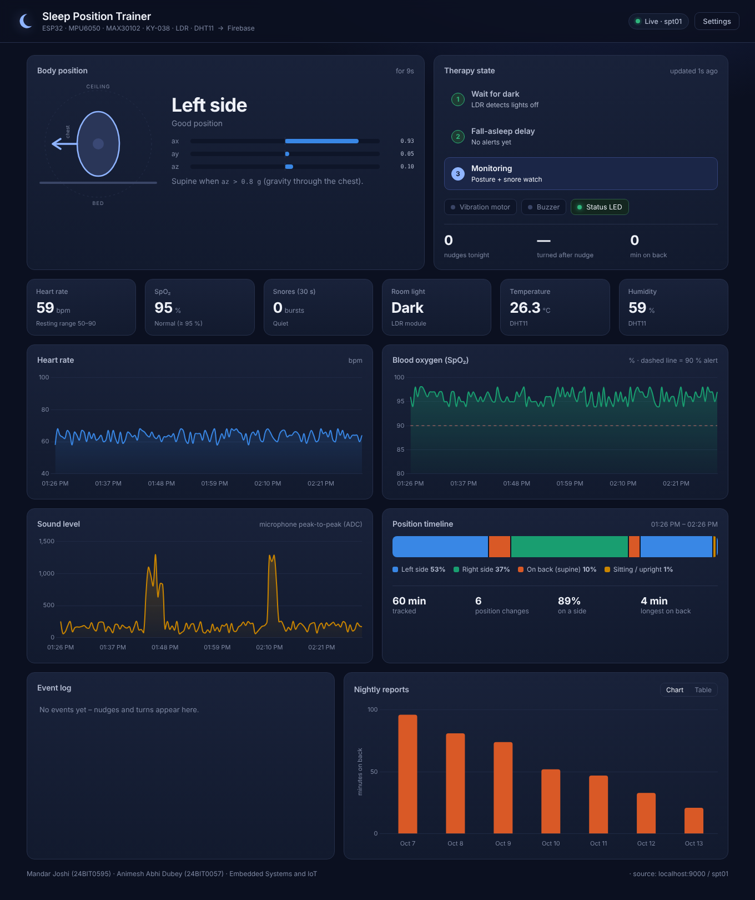
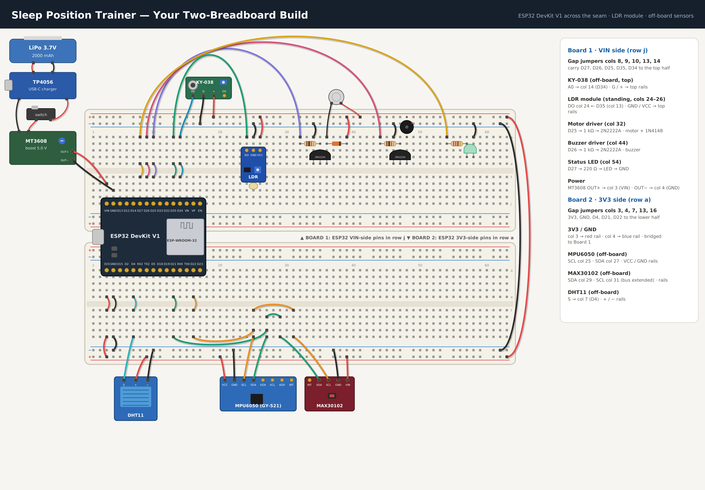

# Sleep Position Trainer – ESP32 IoT

A low-cost wearable that detects back-sleeping (supine position), gently vibrates until the user turns to their side, and logs posture, snoring, heart rate, SpO₂ and room conditions to the cloud with a live web dashboard.

**Team:** Mandar Joshi (24BIT0595) · Animesh Abhi Dubey (24BIT0057)
**Course:** Embedded Systems and IoT



---

## Architecture

```
 ┌──────────────── ESP32 DevKit V1 (firmware/) ────────────────┐
 │ MPU6050 ─┐                                                   │
 │ MAX30102 ┴ I2C (21/22)     state machine                     │
 │ KY-038  → GPIO34 (ADC1)    WAIT_DARK → START_DELAY → MONITOR │
 │ LDR mod → GPIO35           supine (az > 0.8 g) → nudge       │
 │ DHT11   → GPIO4            ignored → buzzer escalation       │
 │ Motor   ← GPIO25 (PWM, 2N2222A)                              │
 │ Buzzer  ← GPIO26 (2N2222A)   LED ← GPIO27                    │
 └───────────────┬──────────────────────────────────────────────┘
                 │ Wi-Fi · HTTPS REST (PUT / POST)
                 ▼
 ┌──────── Firebase Realtime Database (backend/) ───────┐
 │ /devices/spt01/live      latest reading  (every 5 s) │
 │ /devices/spt01/history   chart points    (every 30 s)│
 │ /devices/spt01/events    nudge / turned / escalate   │
 │ /devices/spt01/nights    nightly summary (morning)   │
 └───────────────┬──────────────────────────────────────┘
                 │ Server-Sent Events (REST streaming, real-time)
                 ▼
 ┌──────── Web dashboard (dashboard/) ──────────────────┐
 │ posture · therapy state · vitals · charts · events · │
 │ nightly reports — hosted on GitHub Pages             │
 └──────────────────────────────────────────────────────┘
```

| Folder | What it is |
|---|---|
| `firmware/sleep_trainer/` | Arduino sketch for the ESP32 (sensors, actuators, state machine, Firebase upload) |
| `backend/database.rules.json` | Firebase security rules – dashboard can read, only the device (with secret) can write |
| `backend/simulator/simulate.js` | Pretends to be the ESP32 – sends identical JSON to Firebase for testing |
| `dashboard/` | Static web front end (HTML/CSS/JS + Chart.js), no build step |
| `firebase.json` | Optional: deploy rules + dashboard with the Firebase CLI |

---

## 1 · Try the dashboard (no setup)

Open the GitHub Pages link of this repo, or open `dashboard/index.html` locally.
With no database configured it runs a **built-in simulator** (demo mode) that walks through the full therapy cycle: dark → delay → side → back → nudge → turn → buzzer escalation.

---

## 2 · Create the Firebase backend (free Spark plan, ~5 min)

1. Go to <https://console.firebase.google.com> → **Add project** (Analytics not needed).
2. **Build → Realtime Database → Create database** → pick a location → start in **locked mode**.
3. Copy the database URL shown at the top, e.g. `https://sleep-trainer-xxxx-default-rtdb.asia-southeast1.firebasedatabase.app`.
4. **Rules** tab → paste the contents of [`backend/database.rules.json`](backend/database.rules.json) → **Publish**.
   *Public read of `/devices/*` (for the dashboard), no public write.*
5. **Project settings (⚙) → Service accounts → Database secrets → Show** → copy the secret.
   The ESP32 uses this as `?auth=` and bypasses the rules, so only the device can write.

---

## 3 · Configure and flash the ESP32

1. Arduino IDE → Boards Manager → **esp32 by Espressif (3.x)** · board **DOIT ESP32 DEVKIT V1**.
2. Libraries: *Adafruit MPU6050*, *Adafruit Unified Sensor*, *SparkFun MAX3010x*, *DHT sensor library*.
3. Edit the top of `firmware/sleep_trainer/sleep_trainer.ino`:
   ```cpp
   const char* WIFI_SSID     = "your-wifi";      // 2.4 GHz only (phone hotspot works)
   const char* WIFI_PASS     = "password";
   const char* FIREBASE_URL  = "https://...firebasedatabase.app";  // no trailing slash
   const char* FIREBASE_AUTH = "database secret from step 2.5";
   ```
4. Upload (hold **BOOT** if it says *Connecting…*). Serial Monitor @ 115200 shows `[HTTP] PUT /devices/spt01/live -> 200`.

> Demo timings are enabled (10 s start delay, 3 s supine confirm, 10 s to buzzer, upload every 5 s).
> For real overnight use change them to the values in the comments (15 min / 20 s / 30 s / 60 s).

---

## 4 · Connect the dashboard

Either
- edit `dashboard/config.js` → `databaseURL: "https://..."` and push (GitHub Pages redeploys), **or**
- open the dashboard → **Settings** → paste the URL → *Connect* (saved in that browser), **or**
- use a link: `…/index.html?db=https://...firebasedatabase.app&device=spt01`

The status pill shows **Live** while the device uploads, and **Device offline** if `/live` is older than 30 s.

---

## 5 · Test without hardware (simulator)

```bash
cd backend/simulator
FIREBASE_URL="https://...firebasedatabase.app" FIREBASE_AUTH="secret" node simulate.js --seed
# --seed   also writes 7 nights of reports + 1 h history
# --clear  deletes /devices/spt01
```
Requires Node 18+, no `npm install`.

---

## Data format (written by firmware and simulator)

`/devices/spt01/live`
```json
{ "t":"2026-10-14T23:41:05", "mode":2, "posture":"SUPINE", "ax":0.05, "ay":0.08, "az":0.98,
  "sound":1180, "snores30s":4, "light":0, "temp":26.4, "hum":58, "hr":68, "spo2":94,
  "supineMin":12, "nudges":3, "success":2, "nudging":1, "buzzing":0 }
```
`mode`: 0 = waiting for dark, 1 = fall-asleep delay, 2 = monitoring · `posture`: UPRIGHT / SUPINE / PRONE / LEFT / RIGHT

`/devices/spt01/events/<pushId>` → `{ "t":"…", "type":"nudge|turned|escalate|spo2_dip", "detail":"RIGHT in 12 s" }`

`/devices/spt01/nights/<YYYY-MM-DD>` → `{ "supineMin":21, "nudges":5, "success":4, "escalations":1, "snoreEvents":30, "minSpo2":91, "lastHR":62, "temp":26.1, "hum":58 }`

---

## Hardware



| Sensors (5) | Actuators (3) |
|---|---|
| MPU6050 accelerometer – posture | Coin vibration motor (PWM via 2N2222A + 1N4148 flyback) |
| MAX30102 – heart rate, SpO₂ | Active buzzer (via 2N2222A) |
| KY-038 – snoring | Status LED (220 Ω) |
| HW-072 LDR module – lights off → auto start | |
| DHT11 – room temperature / humidity | |

Power: 3.7 V LiPo → TP4056 charger → switch → MT3608 boost (5.0 V) → VIN. Never power from the battery and USB at the same time.
